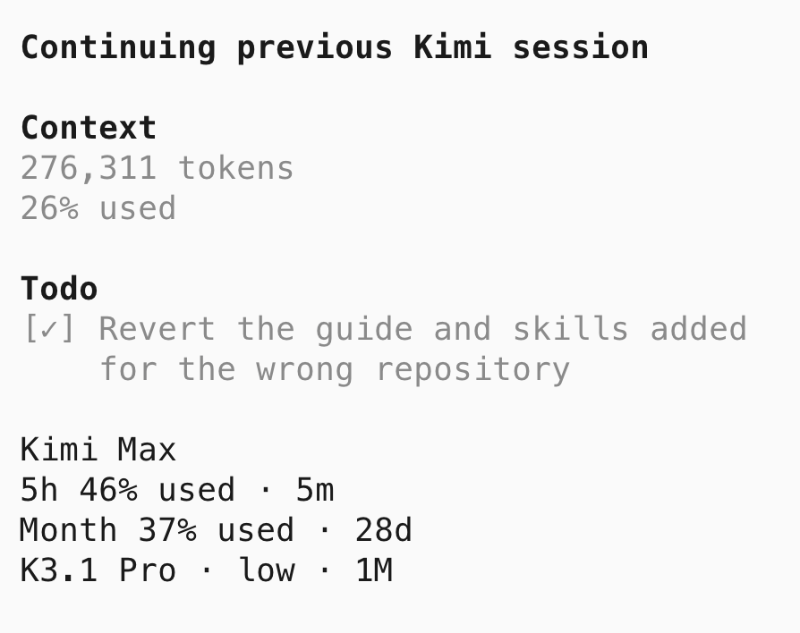

# OpenCode Kimi Meter

A local-first OpenCode V2 TUI plugin for Kimi Coding subscription usage, plan, and model information.



## Features

- Compact sidebar with 5-hour and monthly usage, reset durations, and current model.
- `/kimi` dashboard with plan, region, quota details, Extra Usage when available, and all available models.
- `/kimi-refresh` manual refresh (`/kimi-quota` is an alias).
- Automatic refresh every 60 seconds and after completed turns.
- No credential setup when OpenCode is already authenticated with Kimi Coding.
- No account email, user ID, phone number, or other private profile fields collected or displayed.

## Requirements

- OpenCode V2 with a Kimi Coding provider configured.
- No global Node.js or npm installation is required for normal use; OpenCode supplies the TUI runtime.

## Installation from npm

You do not need to clone this repository or run `npm install`. Add `opencode-kimi-meter` to `~/.config/opencode/cli.json`, preserving any existing plugins:

```json
{
  "plugins": [
    {
      "package": "opencode-kimi-meter",
      "options": {
        "refreshSeconds": 60
      }
    }
  ]
}
```

OpenCode retrieves the package and reloads CLI configuration automatically. Use `/reload` if needed. The sidebar appears when `session.sidebar` is `auto` and terminal width permits it.

## Options

| Option | Default | Purpose |
| --- | --- | --- |
| `refreshSeconds` | `60` | Refresh interval; values below 15 are clamped to 15 |
| `provider` | `kimi-code-plan-global` | Provider key in OpenCode `auth.json` |
| `authPath` | `~/.local/share/opencode/auth.json` | Alternate credential file for testing |
| `baseUrl` | `https://api.kimi.ai/coding/v1` | Kimi Coding API base URL |

`KIMI_CODE_BASE_URL` overrides the default base URL when `baseUrl` is not configured. **Never put API keys in `cli.json`, plugin options, source files, issues, or test fixtures.**

### Mainland China

For the mainland China Kimi Coding provider, use `kimi-code-plan-cn` and `https://api.kimi.com/coding/v1`:

```json
{
  "plugins": [
    {
      "package": "opencode-kimi-meter",
      "options": {
        "provider": "kimi-code-plan-cn",
        "baseUrl": "https://api.kimi.com/coding/v1"
      }
    }
  ]
}
```

Run `opencode auth login` for that provider first so OpenCode's `auth.json` contains a `kimi-code-plan-cn` credential. No credentials are included in this repository.

## Privacy and security

The plugin reads the existing API key from OpenCode's local `auth.json` in memory and uses it only as the Bearer credential for these HTTPS GET requests:

- `/usages`: 5-hour, optional 7-day, monthly coding/total quotas, and Extra Usage wallet metadata;
- `/me`: plan and region only; all other profile fields are ignored; and
- `/models`: public model names, context sizes, and thinking variants.

It never writes or logs credentials, modifies OpenCode credentials, sends analytics, or exposes a network listener. API error bodies are not displayed or logged. Review `src/usage.ts` before installing.

## Development

Node.js 26.4 or later is recommended for development.

```bash
git clone https://github.com/kingychiu/opencode-kimi-meter.git
cd opencode-kimi-meter
npm install
npm test
npm run typecheck
```

For a local checkout, configure the plugin with an absolute package path:

```json
{
  "plugins": [
    {
      "package": "/absolute/path/to/opencode-kimi-meter",
      "options": {
        "refreshSeconds": 60
      }
    }
  ]
}
```

The implementation follows Kimi Code's official managed-usage client (`packages/oauth/src/managed-usage.ts`, `managed-userinfo.ts`, and `managed-kimi-code.ts` in `MoonshotAI/kimi-code`) and OpenCode V2's `sidebar.content` and `session.panel` plugin slots.

## License

MIT
